# King's Valley II — The Seal of El Giza

A C# reconstruction of Konami's 1988 MSX puzzle platformer, supporting **MSX1**, **MSX2** and the **Edit Contest** edition. Built with .NET 10, MonoGame, Nez and Gum.

[](https://github.com/wagenheimer/KingsValley2/actions/workflows/ci.yml)
[](https://dotnet.microsoft.com/download/dotnet/10.0)

Explore connected pyramid rooms, collect every soulstone and reach the exit. Tools, thrown weapons, mummies, rotating doors and collapsing terrain turn each stage into a puzzle. The project reconstructs behavior from cartridge routines and extracts graphics, stages and audio from a supported ROM supplied by the player.

<p align="center">
  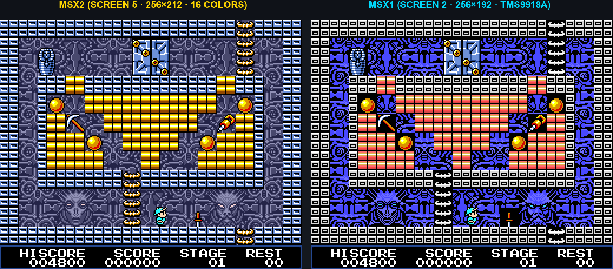
</p>

**No cartridge ROM is included.** Extraction runs inside the application in C#; it does not require openMSX or an installed MSX BIOS. The bundled FRS patch has a separate non-commercial license.

[Get started](#get-started) · [Edit Contest](#edit-contest-edition) · [Accepted ROMs](#exact-supported-cartridges) · [Build](#build-from-source) · [Documentation](#documentation)

## What you can play

| Edition | Content | Presentation and progression |
| --- | --- | --- |
| Original — MSX2 | 60 original stages | Native SCREEN 5 graphics, palettes and animations; original campaign flow. |
| Original — MSX1 | 60 original stages | Native SCREEN 2 graphics, 256×192 centered in the 256×212 frame without stretching. |
| Edit Contest — MSX2 | 20 independent challenges | Publication → author → visual theme → challenge. Separate completion, high scores and save-state slots. |

For the original campaign, extract MSX2 or MSX1, or both. **F11** and **ESC → GRAPHICS** cycle compatible extracted art sets within the current campaign. Contest keeps its own cartridge assets; it does not borrow the original campaign's graphics or audio.

## See it in action

### Explore, collect and escape

Read the room before making your move. Climb ladders, cross connected rooms, collect every soulstone and find the exit. Shovels, pickaxes, hammers and drills reshape the route; knives and boomerangs help you deal with the creatures guarding it. Rotating doors, pushable stones, traps and disappearing golden ladders make movement part of the puzzle.

<p align="center">
  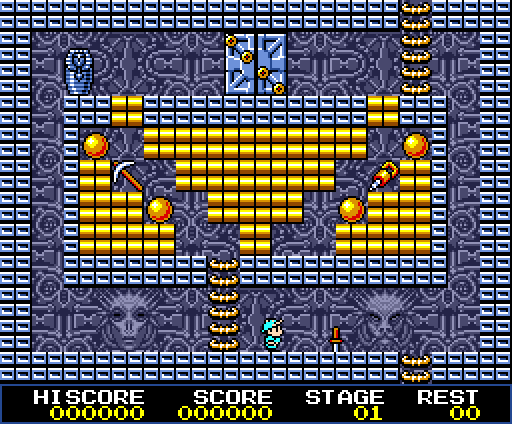
  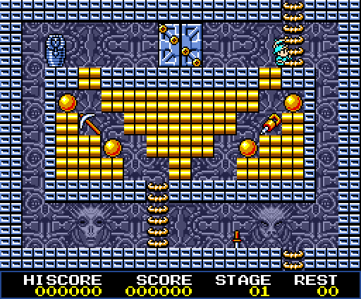
  <br><em>Plan a route, use what the room gives you, and leave with every soulstone.</em>
</p>

### One original campaign, two native presentations

**MSX1 and MSX2 offer the same 60 original stages**, with their own extracted artwork, palette and screen presentation. Switch compatible installed graphics with **F11** or the system menu. Native mural animation and MSX2 palette cycling bring the six pyramid themes to life; MSX1 retains square pixels and its original 256 × 192 image.

<p align="center">
  
  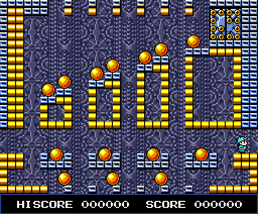
  <br><em>The original 60-stage campaign and the separate 20-challenge Edit Contest collection.</em>
</p>

**Contest adds 20 separate challenges**, selected by publication and author, with a choice of six visual themes. It has its own cartridge assets, records and save slots. Supported Japanese Contest cartridges can receive the bundled English enhancement automatically during offline extraction; see [Edit Contest](#edit-contest-edition).

### Build a stage, then step inside it

Open **EDIT** from the title menu to create a stage or start from an installed Original or Contest stage. Debug builds also provide **F8**. Paint terrain, place tools, enemies and mechanisms, add connected rooms and choose one of six pyramid themes. Work in a focused room or zoom and pan across the **Full stage** view; brush strokes can cross room boundaries and undo as one action.

<p align="center">
  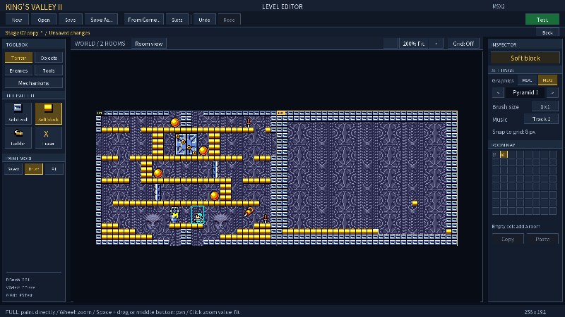
  <br><em>Room and full-stage views share the same editable document.</em>
</p>

Choose **Test** or press **F5** to play your changes in the game. Return with **Escape/F5** and keep your edits, undo history, zoom and camera position. **Save As** exports a portable **`.kv2level`** document to share; recipients need the matching cartridge extraction. Files contain level data without ROM artwork or audio. Ten local level slots, undo/redo, unsaved-change prompts and periodic recovery support longer editing sessions.

<p align="center">
  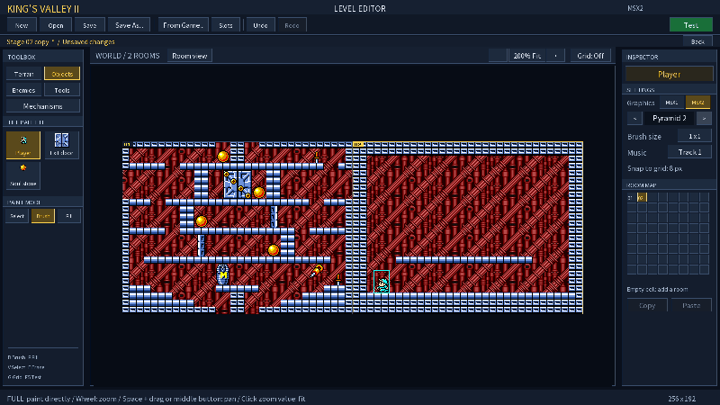
  <br><em>Edit, test and return to the same workspace. See the <a href="docs/en/LEVEL_EDITOR.md">level editor guide</a> for controls and document handling.</em>
</p>

### Keep your place and tune your session

The **ESC system menu** provides three save-state slots with viewport thumbnails, music and effects controls, audio mix, compatible graphics, window mode and available title language. Original and Contest saves remain separate. Use the menu to save, inspect and load slots.

<p align="center">
  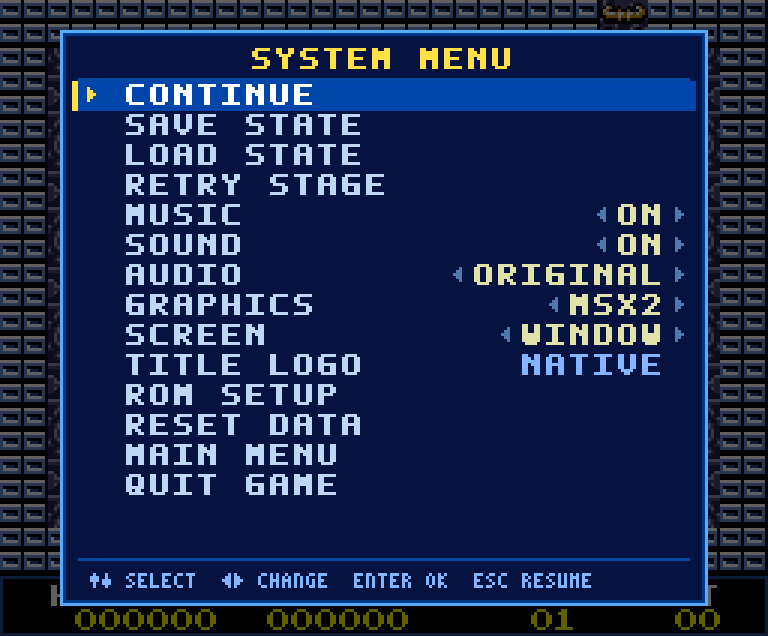
  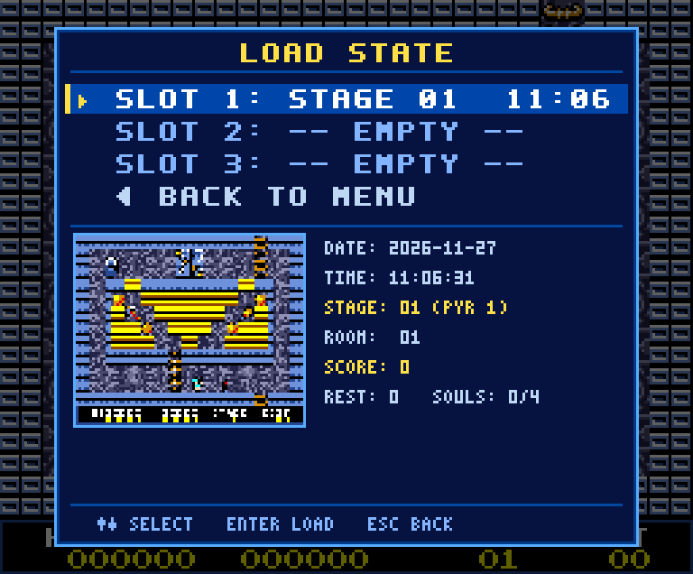
</p>

Beyond the stages, explore cartridge music and effects in **Sound Test** or play the original **5 × 5 sliding puzzle** through the campaign's ending flow. Debug builds also provide direct **F2/F3** shortcuts. Keyboard and gamepad controls are supported, with mouse selection in the desktop menus and editor. [Controls and tools](#controls-and-tools) lists the shortcuts.

Cartridge Setup manages extraction and readiness for each edition. Every extraction attempt produces an offline English HTML report with previews, source identities, inventory checks and limitations. The game extracts from your supplied ROM inside the application; [setup](#get-started) and [reports](#graphics-audio-and-extraction-reports) explain the workflow.

## Get started

Download a package from [Releases](https://github.com/wagenheimer/KingsValley2/releases), or [build from source](#build-from-source). Release packages target Windows x64, Linux x64, macOS Intel and macOS Apple Silicon. Check the release's commit: an older tagged package may not contain the latest changes on `main`.

1. Open **Cartridge Setup**, available on first use and through **F12** or **ROM SETUP** in the system menu.
2. Choose **BROWSE** and select your supported `.rom`, `.bin` or `.zip`. Alternatively, place the ROM beside the executable, in its `roms/` subfolder, or in the folder opened by **FOLDER**, then choose **SCAN**.
3. Select a cartridge and choose **EXTRACT SELECTED**. Browsing or selecting a row does not start extraction on this screen.
4. Wait for the result dialog. Each edition has independent audio and graphics readiness. **ESC** offers cancellation and preserves previous complete generations.
5. Choose **PLAY**. For the special edition, use **GAME → CONTEST** and follow its native selectors.

<p align="center">
  
</p>

The setup footer opens **ROM GUIDE**: press **H**, gamepad **START**, or click the footer. It lists accepted revisions, complete SHA-1 values and recommendations. **RESET DATA** removes extracted content after confirmation; it keeps your original ROM files.

## Edit Contest edition

The **Edit Contest** cartridge is a special collection of custom-stage contest entries, also encountered under **Gold** naming. Its framed opening identifies it as the **Custom stage Contest — Best Entries Collection**. There are **20 challenges**, grouped into four publication award categories with five authors each: **MSX Magazine, Comptiq, MSX-FAN and Beep**.

This is a separate stage collection, rather than an extra difficulty setting for the original 60 stages. Original GoodMSX, official FRS English, JoySNES and the locally validated JoySNES + FRS output are supported, each identified by its own SHA-1.

<p align="center">
  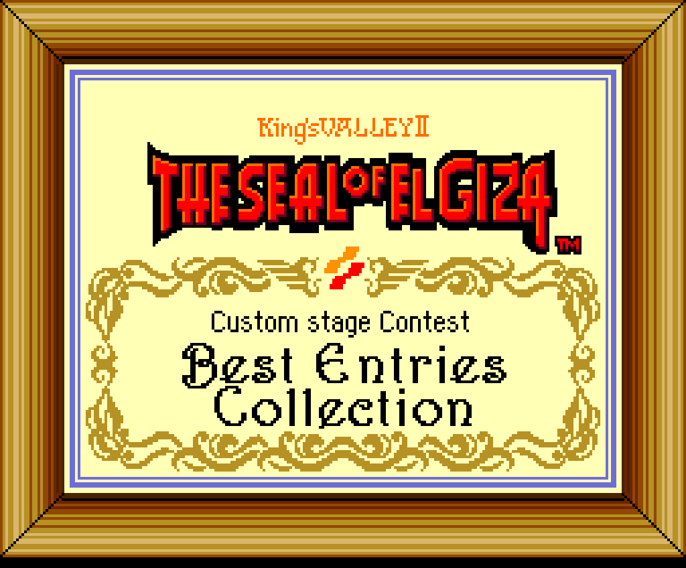
</p>

### The original selection flow

After **GAME → CONTEST**, the port preserves the cartridge's presentation:

1. The framed collection title appears.
2. Select one of the four publication awards.
3. Select one of that publication's five authors.
4. Use **SCREEN SELECT** to choose one of six visual themes, then start the challenge.

<p align="center">
  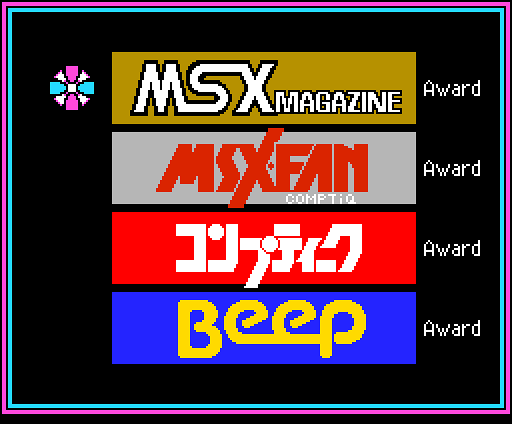
  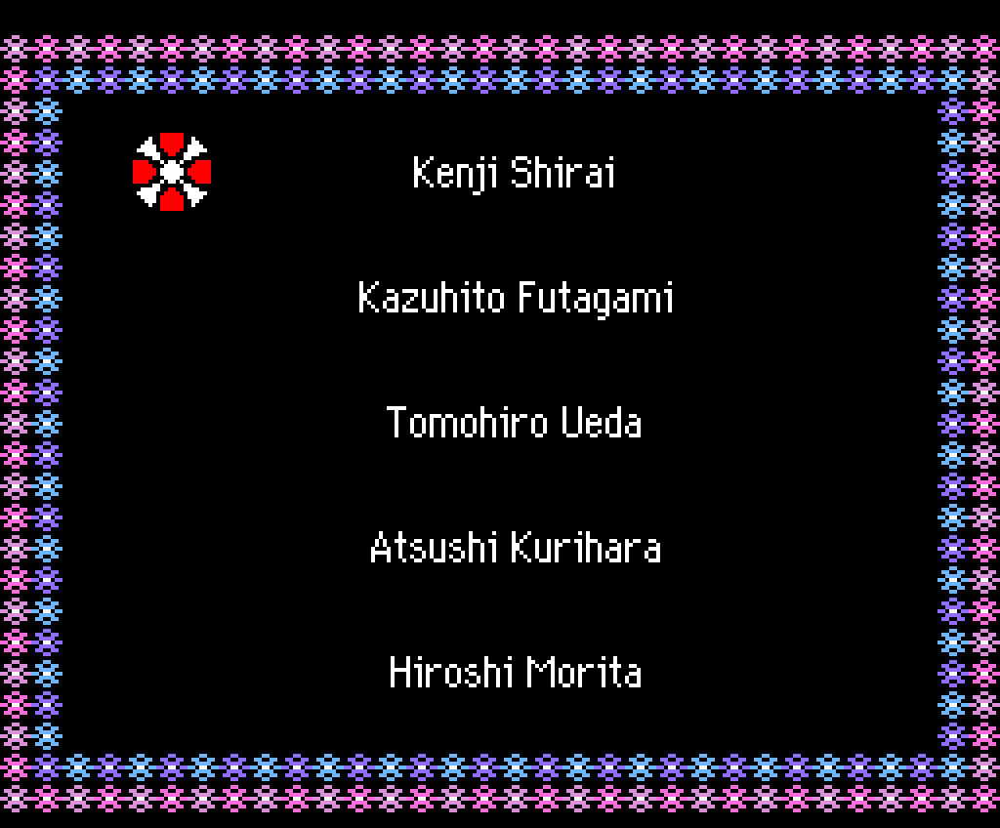
</p>

Use arrows and **ENTER**, or gamepad D-pad and **A**. **ESC/B** returns one step. Mouse selection is supported; click the theme preview to cycle themes and **SCREEN SELECT** to play. Theme selection changes presentation while keeping the challenge layout.

<p align="center">
  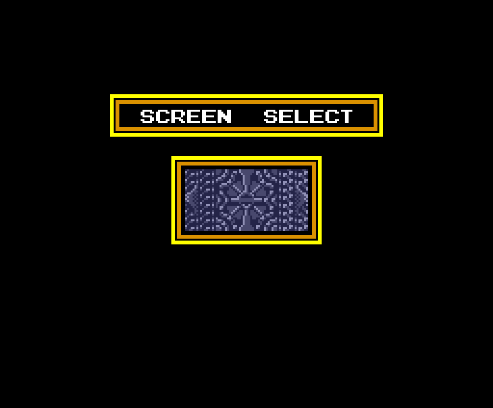
  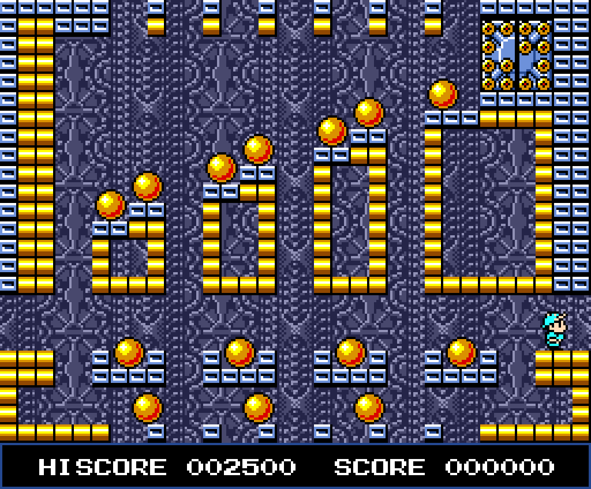
</p>

Completing a challenge plays the door and closing-curtain sequence, displays the cartridge's **CONGRATULATION** screen, then returns to publication selection. Contest does not use the original campaign's world tour, password/bonus sequence or ending puzzle. Its completion records, high scores and save-state slots remain separate from **ORIGINAL**.

### Automatic English translation — offline

Supply either supported **Japanese Contest ROM: original GoodMSX or JoySNES**. During extraction, the game verifies the complete bundled **FRS enhancement patch v1.1** archive, applies `KVAL2G.IPS` to a private working copy and checks the exact resulting SHA-1. English title/menu artwork and romanized author names are extracted from that copy. **Your selected ROM is never overwritten, and no download is needed.**

The original GoodMSX source produces the official FRS English hash; JoySNES produces a separately validated hash. These identities are kept distinct. The 20 extracted stage definitions are checked against their Japanese sources. Audio is captured from the effective cartridge's own driver. Reports record both ROM identities and patch attribution.

FRS documents the Gold translation on the [author's patch page](https://frs.badcoffee.info/patches.html). Credits, hashes, redistribution conditions and the original license are in the [bundled patch documentation](third_party/FRS/README.md). Set `KINGSVALLEY_CONTEST_LANGUAGE=jp` before starting the application for native Japanese diagnostic extraction.

See the [Contest guide](docs/CONTEST_EDITION.md) for stage mappings, native screen recipes, completion timing and validation limits. All five Contest screenshots above were captured from this port using the translated cartridge generation.

## Exact supported cartridges

**You do not need all the ROMs.** Choose one original MSX2 or MSX1 cartridge for the original campaign. Add Contest for its 20 challenges; it needs no companion original cartridge. To have all three presentations/campaigns available, supply MSX2, MSX1 and Contest.

Every accepted image below is **131,072 bytes (128 KiB)**. SHA-1 refers to the **uncompressed ROM inside a ZIP**, not the ZIP itself. Filenames, region tags and cartridge numbers alone do not establish compatibility.

| Revision | ROM SHA-1 | Status |
| --- | --- | --- |
| MSX1 RC-760 original / GoodMSX | `cfd872d005b7bd4cdd6e06c4c0162191f0b0415d` | Supported |
| MSX1 ASCII8 + external SCC slot-2 conversion | `f3306e6f25d111da21ce66db3404f5f48acb25a1` | Supported |
| MSX1 FRS v1.1 | `cb612cbfdf79dabe55164b386ca956a3e187bef7` | Supported |
| MSX1 JoySNES | `7f6c5ec94d35981547a277c308ea9c2d2ab92e0f` | Supported |
| MSX2 RC-761 original / GoodMSX | `5ec8811254dc762c6852289a08acf22954404f0d` | Supported |
| MSX2 ASCII8 + external SCC slot-2 conversion | `f25628e474035e6bf0440b274c5df04f94c49fb8` | Supported |
| MSX2 Ulver crack | `b5acea41aeabb5daa4183953f800d47db0c39fb5` | Supported |
| MSX2 FRS v1.1 | `89d96d4b92d9a1c220cae0240cf0c00f310d14aa` | Supported |
| MSX2 alternate dump (3164) | `22704b82d159d963f1192d7a81810aa2be8b6042` | Supported |
| MSX2 JoySNES | `9ef68fecc91bf5066b9eb9a796412ab00e5746bf` | Supported |
| MSX2 Missing Text (damaged) | `fa750d3f622717fd1dfd0b2740fe69b49ba62ac8` | Partial only: source text is missing |
| MSX2 I/O-mapped conversion (6768) | `c4e138d533525d4b9064b2c265c4d2fdc5fa898d` | Pending: custom loader / I/O mapping |
| MSX2 Edit Contest original / GoodMSX | `2e0436303648097e8e936c5467574aff5e3f1517` | Supported |
| MSX2 Edit Contest FRS v1.1 (English) | `376b4785cab7d60cc083f0c03bd5e8ea2fee8205` | Supported |
| MSX2 Edit Contest JoySNES | `4a157e6e217f6af4ab3dec5d7dd5188e5cef7954` | Supported |
| MSX2 SCC slot patch (project baseline) | `0c7e0b618c72e7ca08bd756c3103b46e5c580c04` | Supported |
| MSX2 Contest JoySNES + FRS local output | `e7b0a7b083d2f5bb12fb4ea6b2e822ee6330a15e` | Supported |
| Legacy boot-patch identity (image not located) | `74eeaa99bff38b332f64e9e9f7775f834d1842e7` | Pending: source image unavailable |

**Recommended:** unmodified GoodMSX originals for MSX1/MSX2; the original GoodMSX
Contest or its official FRS English output for Contest. The JoySNES Contest
remains supported. Both Japanese Contest sources can be translated automatically
offline, each with its own exact output hash.

The slot-2 dumps are ASCII8 conversions that use an external SCC; they now have
separate hardware/audio recipes. The Missing Text dump is recognized and may be
extracted for inspection, but its incomplete generation is not published for play.
The custom I/O conversion and the unavailable legacy boot patch remain explicit
pending cases. Unknown ROM hashes are still rejected until validated.

See [the compatibility audit and source links](docs/ROM_COMPATIBILITY.md) for the
complete catalogue, acquired revisions, validation method and remaining work.
King's Valley I and disk images are not cartridge revisions of this port.

## Graphics, audio and extraction reports

Fixed screens and room backgrounds are assembled **at runtime from native binary data**, not distributed background PNGs. MSX2 uses V9938 SCREEN 5 data; MSX1 uses TMS9918 SCREEN 2 addressing and its native palette. Sprites and atlas regions come from cartridge bytes or captured sprite tables. Rendering uses point sampling and integer scaling; MSX1's 192 rows are centered with ten black rows above and below.

Audio extraction executes a fresh cartridge sound-driver instance per command and records **PSG/SCC register events**. This avoids recording music and effects mixed together during gameplay. The validated Contest capture contains **11 songs and 48 effects**; six additional commands are intentionally silent and reported as such.

The reusable [MSXAudio / MSXScope](https://github.com/wagenheimer/MsxAudio) tools discover packages in the shared collection and can play and inspect them, including individual PSG/SCC channels and wavetable activity.

### Where extracted files go

By default, the collection lives under your user's **Music/MSXMusic** folder. `MSXAUDIO_HOME` overrides that root; both the game and MSXScope use the shared path rules.

```text
<MSXMusic>/kings-valley-2/
├── msx1/
├── msx2/
└── msx2-contest/
    ├── Audio/audio.msxaudio
    ├── Graphics/current.json
    ├── Graphics/generations/<generation-id>/
    └── Report/index.html
```

Every attempted extraction generates an **offline HTML report in English**, including failures and cancellations. It presents screen/sprite previews, audio previews, file inventory, source identities, checks and limitations, including blank or duplicate atlas entries. Open `Report/index.html` in a browser; a web server is not needed.

Graphics generations are immutable and tied to an exact cartridge hash. A partial or failed attempt cannot replace a complete generation. Structural readiness confirms the implemented inventory; it does not prove every pixel, sound or gameplay rule has been exhaustively compared with hardware.

## Controls and tools

| Action | Keyboard | Gamepad |
| --- | --- | --- |
| Move / climb | Arrows or WASD | D-pad / left stick |
| Jump | UP/W when applicable | Up when applicable |
| Contextual action: jump, use tool or throw weapon | SPACE, Z, J or K | Face buttons |
| Confirm in menus | ENTER / SPACE | A |
| System menu | ESC | START |
| ROM Guide in setup | H, or click footer | START |

The contextual action follows the player's state and held tool. In the **ESC system menu**, use arrows to select/change values and ENTER to confirm. Options include music, effects, audio mix, compatible graphics, window mode, available title language, save/load slots, ROM setup and reset. Native MSX1 object backdrops are the default; there is no OBJECTS BG toggle.

| Shortcut | Tool |
| --- | --- |
| F2 | Sound Test (debug build) |
| F3 | Sliding puzzle (debug build) |
| F5 | Return from an editor play-test |
| F6 | Music ending diagnostic (debug build) |
| F7 | Puzzle ending diagnostic (debug build) |
| F8 | Stage editor (debug build) |
| F9 | Game Over diagnostic (debug build) |
| F10 | Main menu (debug build) |
| F11 | Cycle compatible graphics within the current campaign |
| F12 | Cartridge Setup |

The application includes three save-state slots with viewport thumbnails, a stage editor and access to the original ending puzzle. These tools are separate from the Contest cartridge's native stage-selection flow.

The [level editor](docs/en/LEVEL_EDITOR.md) provides a desktop workspace with native room previews, six pyramid themes, room creation, terrain fill, selection, undo/redo and play-testing. **From Game** loads editable copies of all installed Original stages (60 per MSX version) and Contest stages (20). **Save As** exports portable `.kv2level` documents; the ten local slots remain available. Shared levels require the matching cartridge extraction and contain no ROM assets.

## Build from source

Install the [.NET 10 SDK](https://dotnet.microsoft.com/download/dotnet/10.0) and Git, then:

```bash
git clone --recursive https://github.com/wagenheimer/KingsValley2.git
cd KingsValley2
dotnet tool restore
dotnet build KingsValley.slnx
dotnet run --project src/KingsValley.Desktop
```

For an existing checkout, run `git submodule update --init --recursive`. Dependency commits are pinned. `-p:UseExternalMsxDependencies=true` opts into external development checkouts; ordinary builds use the submodules.

Run core tests with:

```bash
dotnet test tests/KingsValley.Core.Tests/KingsValley.Core.Tests.csproj
```

ROM-dependent checks require locally owned cartridges and the documented diagnostic variables. A successful build or inventory check does not establish complete runtime fidelity. See the current [handoff](docs/EXTRACTION_HANDOFF.md) and [graphics audit](docs/GRAPHICS_EXTRACTION_AUDIT.md) for evidence and pending work.

CI builds on Windows, Linux and macOS. Release packaging is defined in [release.yml](.github/workflows/release.yml); platform builds and signing are distinct from hands-on gameplay validation. Maintainers configuring macOS releases should read [signing and notarization](docs/MACOS_SIGNING.md).

### Useful diagnostics

These PowerShell examples assume the required edition has already been extracted:

```powershell
# Open setup without automatic extraction.
$env:KINGSVALLEY_START_SCENE = 'setup'
dotnet run --project src/KingsValley.Desktop

# Open the translated Contest author selector.
$env:KINGSVALLEY_GFX = 'msx2-contest'
$env:KINGSVALLEY_START_SCENE = 'contest'
$env:KINGSVALLEY_CONTEST_MENU = 'author'
dotnet run --project src/KingsValley.Desktop
```

Environment values persist in the current shell. Clear diagnostic overrides when returning to normal play. More examples, input scripts and screenshot controls are in the [English documentation](docs/en/README.md) and [Contest guide](docs/CONTEST_EDITION.md).

## Documentation

| Resource | What it covers |
| --- | --- |
| [English documentation](docs/en/README.md) | Gameplay illustrations and technical guides |
| [Game design](docs/GAME_DESIGN.md) | Cartridge behavior and measured game rules |
| [ROM extraction](docs/ROM_EXTRACTION.md) | Supported identities, native formats and independent pipelines |
| [Edit Contest](docs/CONTEST_EDITION.md) | Edition-specific menus, stages, themes and completion |
| [Golden ladders](docs/GOLDEN_LADDERS.md) | Native use counters and disappearance behavior |
| [Extraction handoff](docs/EXTRACTION_HANDOFF.md) | Current engineering checkpoint and next validation work |
| [Graphics audit](docs/GRAPHICS_EXTRACTION_AUDIT.md) | Inventory, source evidence and fidelity limits |
| [FRS patch credits and license](third_party/FRS/README.md) | Offline translation provenance and redistribution terms |

```text
src/KingsValley.Core/        Game rules, stages, saves and native-data assembly
src/KingsValley.Engine/      Extraction recipes, rendering, scenes and UI
src/KingsValley.Desktop/     Desktop launcher and content configuration
src/Wagenheimer.MsxGraphics/ Reusable graphics formats and HTML reporting
lib/MsxAudio/               Reusable audio extraction, playback and MSXScope
lib/MonoGameHelper/         Window/layout helpers
lib/Nez/                    Scene framework
tests/                      Automated checks and optional local-ROM comparisons
third_party/FRS/            Complete original patch archive and attribution
```

## Credits and distribution

**King's Valley II: The Seal of El Giza** and its original game content belong to **Konami**. This is an independent reconstruction and preservation project, not an official Konami release. Complete cartridge ROMs and extracted game asset packages are not distributed in this repository; obtain and supply your own supported ROM.

The **FRS enhancement patches v1.1**, copyright 2011 FRS, retain their own license. They permit non-commercial use and redistribution only as the complete original archive; commercial use requires permission from FRS, and patched ROMs must not be redistributed. These terms also matter when distributing a build containing the archive.

Translation contributors credited in the original package: **Jazzin, BiFi, Vampier, pegase, Metalion and iamweasel2**. Logo contributors: **SLotman and pegase**. The complete, controlling license and credits remain in `README.TXT` inside the [unmodified bundled ZIP](third_party/FRS/KingsValley_II_EnhancementPatches.zip).

Thanks to the **openMSX** project for its implementation references, debugger and software database used in research. The shipped extractor runs independently; it does not invoke openMSX. MonoGame, Nez, Gum, MSXAudio and other dependencies retain their respective licenses.
