# King's Valley II — The Seal of El Giza
### Faithful MSX2 & MSX1 Port in C# / .NET 10 · MonoGame · Nez · Gum

[](https://dotnet.microsoft.com/)
[](https://monogame.net/)
[](LICENSE)
[]()
[]()

A high-fidelity, reverse-engineered 1:1 re-implementation of Konami's classic **King's Valley II: The Seal of El Giza** (MSX2 / MSX1, 1988), built natively in modern **C# / .NET 10** using **MonoGame**, the **Nez** 2D framework, and **Gum UI**.

Every stage layout, enemy behavior, puzzle mechanism, physical jump curve, and sound effect has been faithfully reconstructed from the original Konami Z80 ROM instructions and VDP memory mappings — running at a buttery-smooth native frame rate without any CPU emulation overhead.

---

## 🏛️ Dual-Engine Graphics: MSX2 & MSX1 Support

The engine features full real-time graphics switching between **MSX2 SCREEN 5** and **MSX1 SCREEN 2**. You can toggle between them at any moment during gameplay via **F11** or from the in-game **System Menu (ESC)**.

<p align="center">
  
</p>

| Feature | MSX2 Mode (SCREEN 5) | MSX1 Mode (SCREEN 2) |
| :--- | :--- | :--- |
| **Resolution** | **256 × 212** (MSX2 frame) | **256 × 192** (TMS9918A standard) |
| **Color Model** | 16-color palette per pixel with smooth shading | 2 colors per 8-pixel row (authentic attribute color clash) |
| **Aspect Ratio** | Crisp 1:1 square pixels | Crisp 1:1 square pixels centered with **10 px letterbox** (never stretched) |
| **Cenography** | Continuous hardware palette color-6 cycling (flames & gold) | Animated mural patterns (blinking eyes decoded byte-for-byte from VRAM) |
| **Architecture** | Runtime assembled from 4bpp nibble blocks & murals | Decoded from SCREEN 2 bank-switched pattern/color tables |

---

## 💾 ROM Setup & Built-in Extractor (First Run)

To respect Konami's intellectual property, **this open-source repository contains zero copyrighted ROM data, proprietary bitmaps, or audio files**.

On first boot (or anytime by pressing **F12**), the built-in retro MSX setup screen guides you through configuring your cartridges:

<p align="center">
  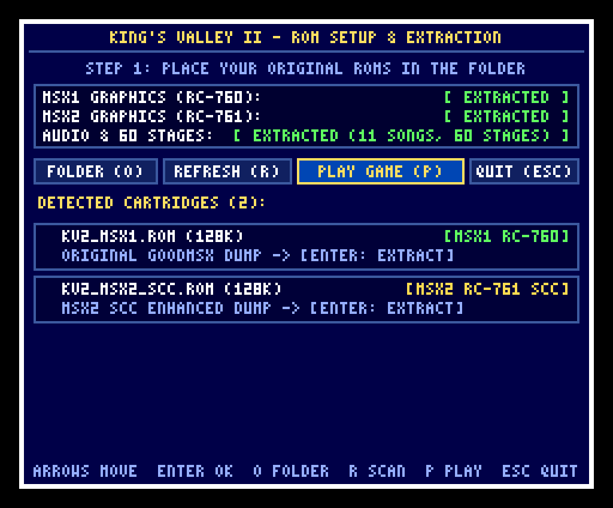
  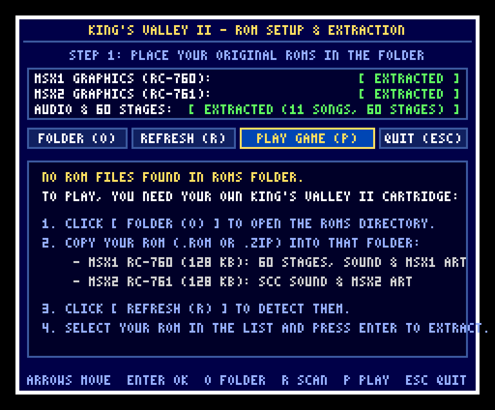
</p>

### How to Set Up Your ROMs:

1. **Open the ROMs Folder:**
   - Click **`FOLDER (O)`** or press the **`O`** key. The game automatically opens the local directory in your system file manager (`%APPDATA%\KingsValley\roms\` on Windows, or `./roms/` in portable mode).
2. **Place Your Original ROM(s) in the Folder:**
   - **MSX1:** `King's Valley II (JP) [RC-760].rom` (128 KB, SHA-1 `cfd872d005b7bd4cdd6e06c4c0162191f0b0415d`) — Contains all 60 stages, PSG sound driver, and SCREEN 2 graphics.
   - **MSX2:** `King's Valley II (JP) [RC-761] [SCC].rom` (128 KB / 256 KB) — Contains SCC audio driver and MSX2 SCREEN 5 graphics.
   - Standard `.rom`, `.bin`, and `.zip` archives are recognized and identified automatically via SHA-1 and cartridge hardware headers.
3. **Scan and Detect:**
   - Click **`REFRESH (R)`** or press **`R`**. The detected cartridges will appear with detailed version tags and sizes.
4. **Extract with One Click:**
   - Select your cartridge using keyboard arrows, mouse, or gamepad, and press **`ENTER`** (or click it). The built-in emulator runs the sound driver in-process and unpacks stages and screens.
5. **Play with Either ROM:**
   - Even if you only have one cartridge (MSX1 or MSX2), the **`PLAY ANYWAY (P)`** button enables immediately so you can jump straight into the game!
   - If you attempt to switch to an unextracted graphics flavor during gameplay (via **F11** or the **ESC** system menu), the game gracefully returns to the setup screen with an informative alert:

<p align="center">
  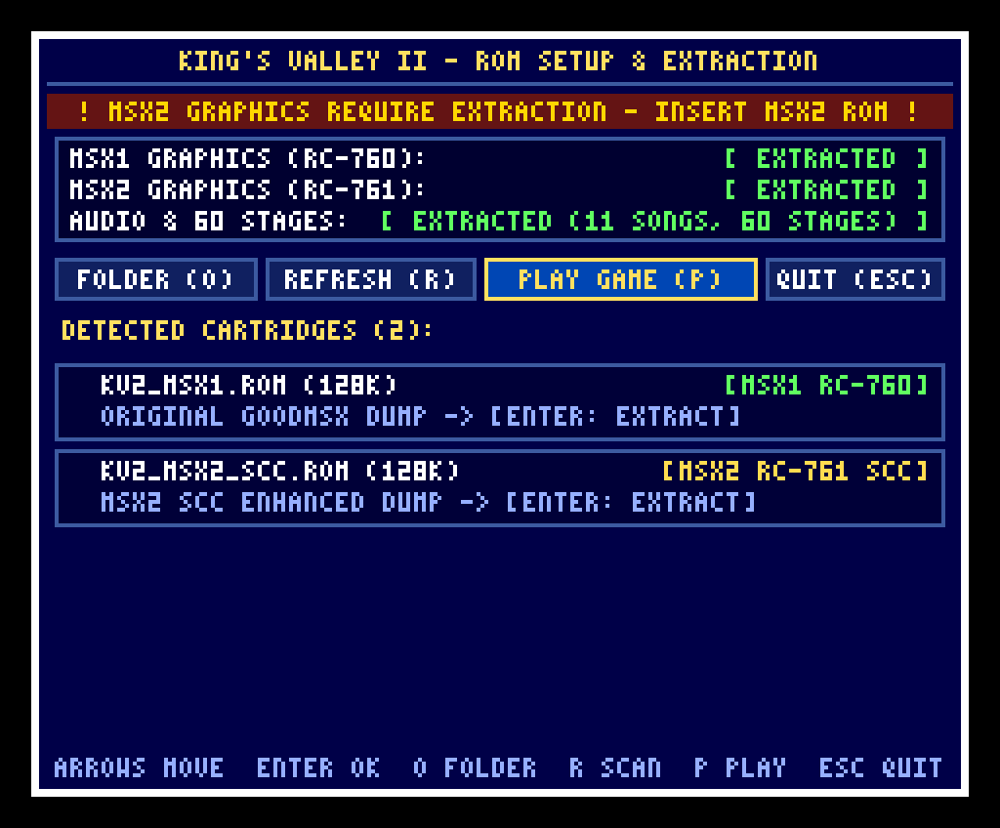
</p>

---

## 🎵 Legendary 8-Channel Soundtrack & Audio Architecture (PSG + SCC)

The soundtrack of *King's Valley II* is celebrated as one of the finest musical achievements of the 8-bit era, composed by Konami's legendary sound team:
* **Motoaki Furukawa** (*Gradius II, Vulcan Venture, Snatcher*)
* **Kinuyo Yamashita** (*Castlevania / Akumajō Dracula, Esper Dream, Mega Man X3*)
* **Kazuhiko Uehara** (*Tiny Toon Adventures, Teenage Mutant Ninja Turtles*)
* **Masahiro Ikariko** (*Metal Gear, Snatcher, Salamander*)
* **Michiru Yamane** (*Castlevania: Symphony of the Night, Bloodstained*)

### The Hybrid 8-Channel Audio Engine:
Contrary to widespread misconception, **an official "PSG-only" release of King's Valley II never existed**. Both the MSX1 edition (**RC-760**) and MSX2 edition (**RC-761**) were physically manufactured as Konami MegaROM cartridges featuring the custom **Konami SCC (Sound Creative Chip / K051649)** wavetable synthesizer soldered directly onto the PCB:

<p align="center">
  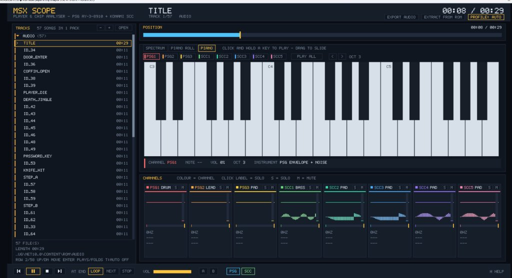
</p>

* **3 Built-in PSG Channels (AY-3-8910):** Dedicated to snappy percussions, white noise bursts, hi-hats, and rhythmic accents.
* **5 Custom SCC Channels (K051649):** Delivering rich 32-byte cyclic wavetable synthesis, punchy basslines, and melodic synth harmonies.
* **8 Voices in Total:** Konami's Z80 sound driver commands both chips in tandem, delivering a multi-timbral depth that redefined home computer gaming audio in 1988.

### Inspect & Listen with the `MSXAudio` Player / Analyzer
Once the game extracts the audio on first boot, the entire soundtrack and sound effects library are stored as pure cycle-accurate VGM logs inside `%APPDATA%\KingsValley\extracted\audio.msxaudio`.

You can open, analyze, and play this exact package using our standalone audio suite **[MSX Scope / Wagenheimer.MsxAudio](https://github.com/wagenheimer/MsxAudio)**:
* **Real-time Chip Analyzer:** Inspect all 8 individual channels, mute/solo instruments (`PSG1..3`, `SCC1..5`), and toggle stereo panning profiles.
* **Live Wavetable Scope:** Watch the 5 dynamic 32-byte SCC waveforms oscillate in real-time as notes are synthesized.
* **Interactive Keyboard & Piano Roll:** Visualize note events, inspect envelopes, and study Konami's master sound arrangements note-by-note.

---

## 🎮 In-Game System Menu & Instant Save States

Pressing **ESC** at any time during gameplay opens the in-game System Menu, rendered natively with retro MSX aesthetics:

<p align="center">
  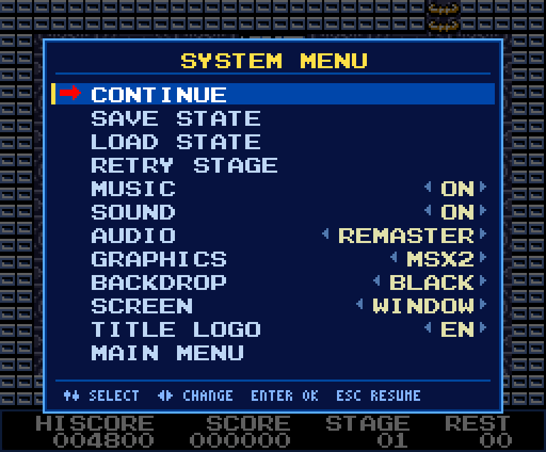
</p>

* **3 SaveState / LoadState Slots:** Instantly snapshot the exact room state — including player coordinates, enemy positions, pathfinder state, thrown weapons, and door angles.
* **Live Viewport Thumbnails:** Each save slot stores a crisp 128×106 thumbnail captured directly from the game viewport without black bars.
* **Runtime Toggles:** Switch audio engines (Remastered / PSG / SCC), swap graphics flavors (MSX2 / MSX1), change backdrop borders, toggle fullscreen, or switch title logos (English / Japanese) on the fly.

---

## ⚡ Core Gameplay & Physics Mechanics

All room mechanics are dynamically assembled and simulated at runtime. No pre-baked image backgrounds are used:

<p align="center">
  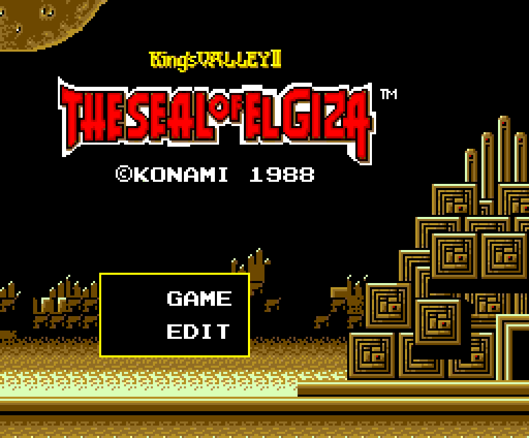
  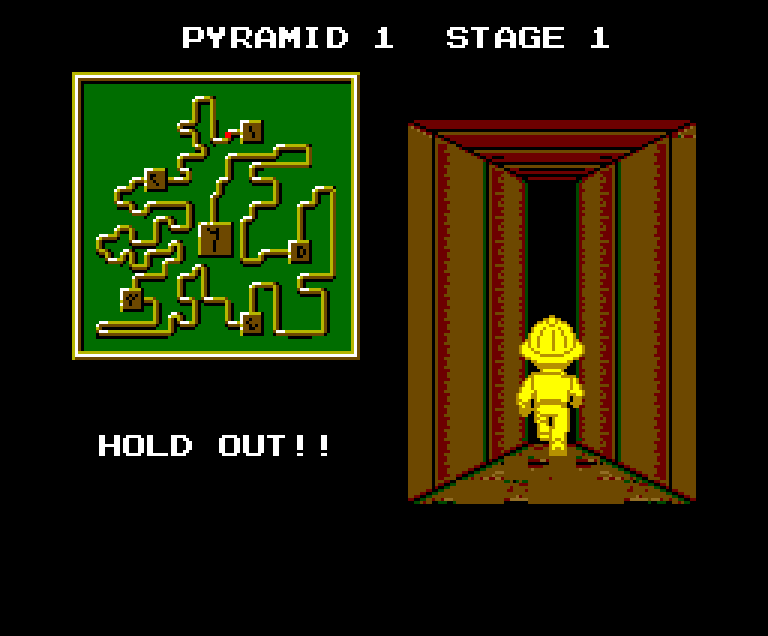
</p>

| Mechanic | Demonstration | Details |
| :--- | :---: | :--- |
| **Combat & Throwing** | 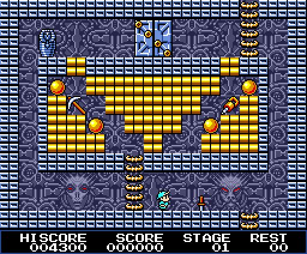 | Jump arcs, throwing knives, boomerangs with return trajectories, and precise weapon pickup collision boxes. |
| **Revolving Doors** | 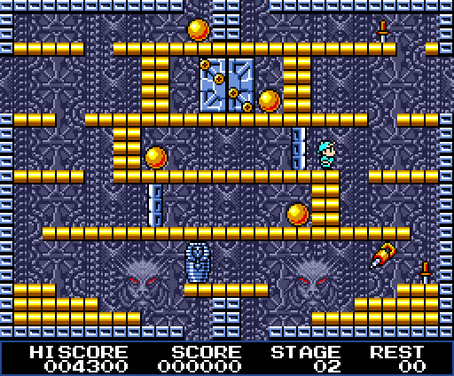 | Full simulation of Type 1 push doors and Type 2 one-way 4-phase revolving doors (`0 → 1 → 2 → 3 → 0`) with dynamic background mural restoration. |
| **Sandstone Digging** | 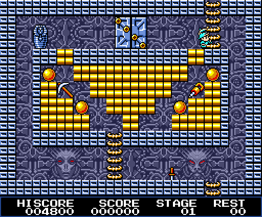 | Authentic 3-stage block crumbling animation with pickaxe tools, matching the original MSX tick timing. |
| **Traps & Pitfalls** | 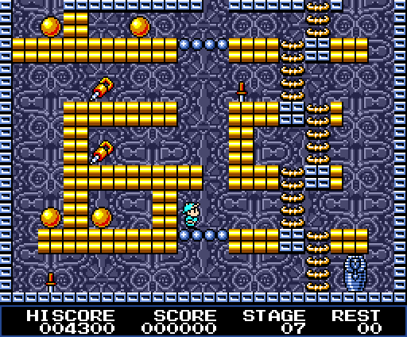 | Retractable trapdoors that open under actors and snap shut, restoring the wall mural tiles behind them. |
| **Enemy AI & Physics** | 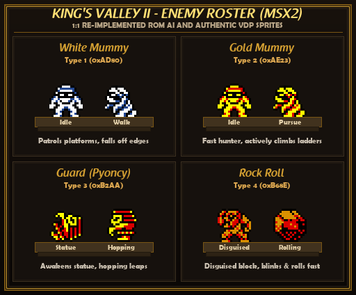 | White Mummies, fast Gold Mummies, bouncing guards (*Pyoncy*), and rolling boulders (*Rock Roll*) traced from original ROM algorithms. |

---

## 🛠️ Built-In Tools & Secret Modes

<p align="center">
  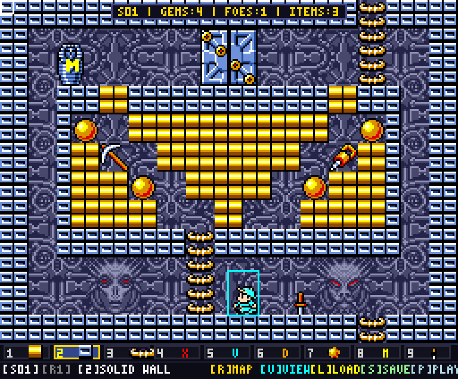
  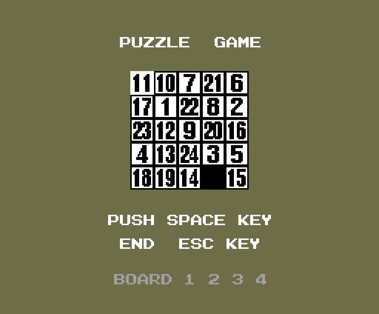
</p>

* **Integrated Stage Editor:** Create, edit, and playtest custom levels directly inside the game with full brush palettes (sandstone, ladders, doors, enemies, soul stones). Press **F8** to open.
* **Secret 5×5 Sliding Puzzle:** Complete recreation of the hidden post-game sliding puzzle minigame from the Konami cartridge, featuring 4 board layouts and 1UP rewards. Press **F7** to test.
* **Sound Test / Jukebox:** Complete player for all 19 Konami music tracks and sound effects rendered via accurate AY-3-8910 (PSG) and K051649 (SCC) emulation. Press **F2** to test.

---

## 🚀 Building & Running

### Prerequisites
* [.NET 10 SDK](https://dotnet.microsoft.com/download/dotnet/10.0) or later.
* Git with recursive submodule support.

### Clone and Run
```bash
# Clone the repository including submodules
git clone --recursive https://github.com/wagenheimer/KingsValley2.git
cd KingsValley2

# Restore dotnet tools
dotnet tool restore

# Build solution (Release mode)
dotnet build KingsValley.slnx -c Release

# Run test suite (147 automated unit tests)
dotnet test

# Launch the game
dotnet run --project src/KingsValley.Desktop
```

---

## ⌨️ Controls & Shortcuts

### Player Controls
| Action | Keyboard | Gamepad (Xbox / Generic) |
| :--- | :--- | :--- |
| **Move Left / Right** | Left / Right Arrow or `A` / `D` | D-Pad Left / Right or Left Stick |
| **Climb Ladders** | Up / Down Arrow or `W` / `S` | D-Pad Up / Down or Left Stick |
| **Jump** | `Up Arrow`, `W`, or `Space` | Button `A` or `X` |
| **Use Weapon / Dig** | `Space`, `Z`, `J`, or `K` | Button `B` or `Y` |
| **System Menu (Pause)** | `Escape` | `Start` / `Menu` |

### Developer & Debug Shortcuts
| Shortcut | Function |
| :--- | :--- |
| `F2` | Open Sound Test / Jukebox |
| `F5` | Quick restart current room |
| `F6` | Quick SaveState snapshot |
| `F7` | Open Ending Puzzle minigame |
| `F8` | Open Integrated Stage Editor |
| `F9` | Trigger Game Over screen |
| `F10` | Return to Main Menu |
| `F11` | Cycle Graphics Flavor (**MSX2** ↔ **MSX1**) |
| `F12` | Open ROM Extractor dialog |
| `B` | Skip to previous stage (Debug) |
| `T` | Cycle in-game stage music tracks |

---

## 🔬 Diagnostic Environment Variables

For automated testing, screenshot generation, and CI pipelines, the game can be launched directly into any scene, stage, or graphic mode:

```bash
# Launch directly into Stage 3 in MSX2 mode with instant spawn
KINGSVALLEY_START_SCENE=level KINGSVALLEY_LEVEL=3 KINGSVALLEY_GFX=msx2 dotnet run --project src/KingsValley.Desktop

# Launch directly into the ESC System Menu
KINGSVALLEY_START_SCENE=level KINGSVALLEY_LEVEL=1 KINGSVALLEY_SYSMENU=1 dotnet run --project src/KingsValley.Desktop

# Launch in MSX1 retro flavor
KINGSVALLEY_GFX=msx1 dotnet run --project src/KingsValley.Desktop
```

---

## 📜 Project Structure

```text
KingsValley/
├── KingsValley.slnx               # Modern .NET solution file
├── README.md                      # Project documentation and guide
├── docs/                          # In-depth technical documentation
│   ├── GAME_DESIGN.md             # Original game design document & formulas
│   ├── ARCHITECTURE.md            # Nez / MonoGame engine design
│   ├── ROM_ENGINEERING.md         # Z80 timing, memory maps & VDP registers
│   └── en/media/                  # High-definition showcase screenshots & GIFs
├── lib/
│   ├── Nez/                       # Nez 2D framework
│   ├── MsxAudio/                  # AY-3-8910 (PSG) & K051649 (SCC) sound emulation
│   └── MonoGameHelper/            # Cross-platform window and layout helpers
├── src/
│   ├── KingsValley.Core/          # Pure C# logic: physics, room assembler, save system
│   ├── KingsValley.Engine/        # MonoGame / Nez scenes, Gum UI, audio host, ROM extractor
│   └── KingsValley.Desktop/       # DesktopGL launcher, windowing, app icon
└── tests/
    └── KingsValley.Core.Tests/    # 147 automated unit tests
```

---

## 📦 Pre-built Binaries

Ready-to-run standalone packages are automatically built by GitHub Actions for every release:

- **Windows x64** (`KingsValley2-v1.0.0-Windows-x64.zip`)
- **Linux x64** (`KingsValley2-v1.0.0-Linux-x64.tar.gz`)
- **macOS x64** (Intel) (`KingsValley2-v1.0.0-macOS-x64.zip`) — Native `.app` bundle
- **macOS Apple Silicon** (`KingsValley2-v1.0.0-macOS-AppleSilicon.zip`) — Native `.app` bundle

Download them from the [Releases Page](https://github.com/wagenheimer/KingsValley2/releases).

### macOS signing and notarization (CI secrets)

`tools/macos/package_app.sh` always removes the quarantine attribute and deep-signs the
`.app`. Without a Developer ID it signs ad-hoc, which is enough to run locally but still
shows a Gatekeeper warning on a fresh download. To publish a notarized build, configure
these GitHub repository secrets:

| Secret | Purpose |
| --- | --- |
| `MACOS_SIGN_IDENTITY` | `Developer ID Application: Name (TEAMID)` |
| `MACOS_CERT_P12` | Base64 of the `.p12` certificate + private key |
| `MACOS_CERT_PASSWORD` | Password of the `.p12` file |
| `MACOS_KEYCHAIN_PASSWORD` | Password for the temporary runner keychain |
| `APPLE_API_KEY` | Base64 of the App Store Connect `.p8` API key |
| `APPLE_API_KEY_ID` | Key ID of the `.p8` key |
| `APPLE_API_ISSUER` | Issuer ID of the App Store Connect API |

Alternatively, use `APPLE_ID`, `APPLE_TEAM_ID` and `APPLE_APP_PASSWORD` (app-specific
password) instead of the API key trio. Add them in **Settings → Secrets and variables →
Actions → New repository secret**. The values are encrypted, masked in workflow logs and
are never included in the repository or in the downloaded archives; they are also not
available to workflows triggered by pull requests from forks. A paid Apple Developer
Program membership and a `Developer ID Application` certificate are required.

All secrets are optional: forks and local builds still produce a valid ad-hoc signed
bundle. The release job verifies the result with `codesign --verify --deep --strict` and,
when signed with a Developer ID, `spctl`. Signing with a Developer ID uses
`tools/macos/Entitlements.plist` (`com.apple.security.cs.allow-jit` and
`com.apple.security.cs.allow-unsigned-executable-memory`), which is required for a
self-contained .NET app with the hardened runtime. Once the secrets are configured, a new
release build is notarized and staple-attached, so macOS Gatekeeper accepts it without
the "unknown developer" warning.

---

## 📄 License & Disclaimer

* **Engine & Source Code:** Released under the [MIT License](LICENSE).
* **Game Concept, Level Designs & Audio:** King's Valley II is © 1988 Konami. This project is a non-commercial educational tribute and preservation effort. No copyrighted assets are distributed with this repository.
