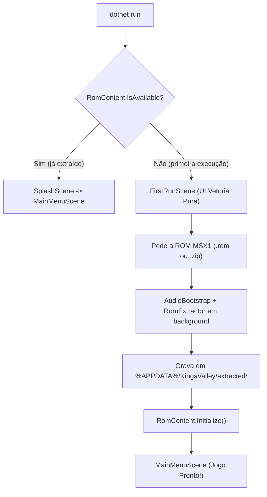

# Preparação para o Repositório Open-Source (Clean / Zero-Asset)

Este documento especifica a estratégia e o passo-a-passo para a criação do **repositório público/open-source** do **King's Valley II**.

---

## 1. Princípio Fundamental de Legalidade

- **Nenhum arquivo binário da Konami é versionado no repositório público:**
  - Sem ROMs (`.rom`, `.dsk`).
  - Sem dumps VRAM/VDP (`Content/Rom/`, `Content/RomMsx1/`).
  - Sem arquivos de áudio extraídos (`.msxaudio`, `.vgm`).
  - Sem pastas de trabalho do emulador (`tools/kv2-extract/work/`).
- **O código-fonte (C#), a engine, as ferramentas de extração e a UI procedural são 100% de nossa autoria e open-source.**
- O jogo implementa um fluxo de **First Run Bootstrap**:
  - Se os assets não existirem localmente, o jogo inicializa diretamente na tela embutida `FirstRunScene`.
  - Esta tela é desenhada inteiramente por código procedural (`MsxScreen.MiniText` e `MsxScreen.Fill`), não dependendo de nenhuma textura, fonte proprietária ou PNG.
  - O jogador fornece a sua própria cópia da ROM (arrastando para a janela ou navegando pelo seletor de arquivos in-game).
  - O extrator local processa a ROM do usuário e salva os assets na pasta de dados do usuário: `%APPDATA%\KingsValley\extracted\`.
  - A camada `RomContent` e `RoomAssembler` prioriza `%APPDATA%\KingsValley\extracted\` automaticamente.

---

## 2. Inventário de Arquivos: O que FICA vs o que SAI

### ✅ Arquivos que ENTRAM no repositório público (Open-Source):
```text
KingsValley/
├── .gitignore                      # Configurado para ignorar ROMs e caches extraídos
├── KingsValley.slnx                # Solução .NET
├── README.md                       # Documentação completa com instruções de compilação e extração
├── AGENTS.md                       # Regras de arquitetura e desenvolvimento
├── docs/                           # Toda a documentação de engenharia reversa, design e arquitetura
│   ├── GAME_DESIGN.md
│   ├── ARCHITECTURE.md
│   ├── ROM_EXTRACTION.md
│   ├── ROM_ENGINEERING.md
│   ├── en/                         # Documentação em inglês e GIFs ilustrativos de gameplay
│   └── ...
├── lib/
│   └── Nez/                        # Submódulo ou vendor da engine Nez (MIT)
├── tools/
│   └── kv2-extract/                # Scripts Python e Tcl de extração (nossos scripts de engenharia reversa)
│       ├── art/
│       ├── emulator/
│       └── README.md
├── tests/
│   └── KingsValley.Core.Tests/     # Testes unitários do Core (142+ testes xUnit)
└── src/
    ├── KingsValley.Core/           # Regras puras do jogo, decodificadores VDP e simuladores (C# puro)
    ├── KingsValley.Engine/         # Pipeline Nez, montadores de tela, áudio, UI Gum, cenas
    └── KingsValley.Desktop/        # Program.cs + Content não-proprietário:
        └── Content/
            ├── Gum/                # Projetos de UI Gum (.gumx, .gucx, .gusx)
            └── Localization/       # Textos e traduções do jogo
```

### ❌ Arquivos que FICAM DE FORA (Exclusivos do repo privado / gerados localmente):
```text
Content/Rom/                        # Gráficos, telas e fases MSX2 extraídos
Content/RomMsx1/                    # Gráficos, telas e dumps MSX1 extraídos
tools/kv2-extract/work/             # ROMs originais e dumps intermediários de emulador
Content/Gum/FontCache/              # Fontes rasterizadas em tempo de compilação
%APPDATA%/KingsValley/extracted/    # Cache local gerado na máquina do jogador
```

---

## 3. O Fluxo de Inicialização Limpa (Clean First-Run)

Quando um usuário clona o repositório público e executa `dotnet run`:



---

## 4. Checklist para a Criação do Novo Repositório

1. [x] **Arquitetura Zero-PNG validada**: todas as 60 fases e todas as telas de menu/abertura são montadas a partir de dados binários via `SetData<Color>()`, sem PNGs estáticos.
2. [x] **FirstRunScene embutida**: suporte a navegação por teclado, gamepad e mouse para selecionar a ROM e extrair em tempo real.
3. [x] **Suporte prioritário a `%APPDATA%\KingsValley\extracted\`**: o runtime do jogo já carrega os dados extraídos pelo usuário com prioridade total sobre a pasta `Content/`.
4. [ ] **Script de exportação/filtro**: criar script `tools/export_clean_repo.ps1` que gera uma cópia limpa do projeto pronta para `git init` e envio ao repositório público.
5. [ ] **Atualização do `.gitignore`**: assegurar que nenhuma ROM ou pasta `Rom/` seja incluída por engano.
