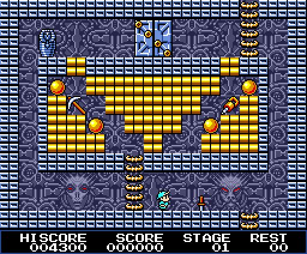
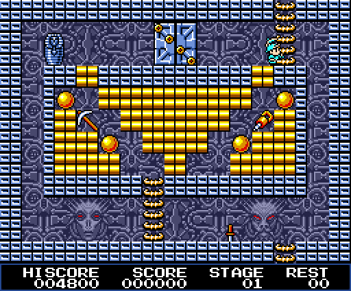
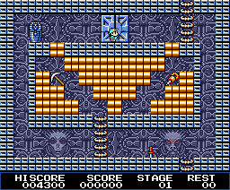
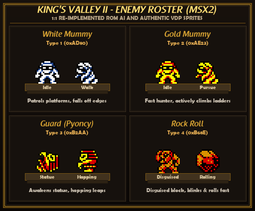
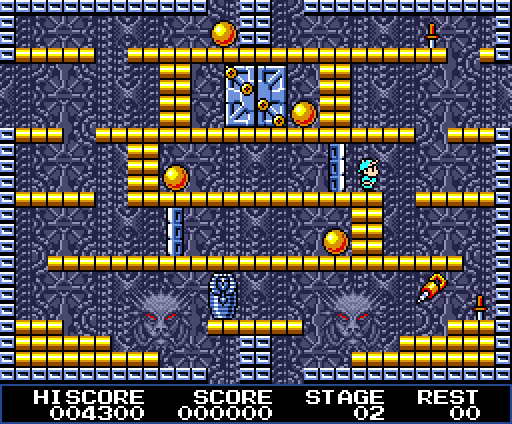
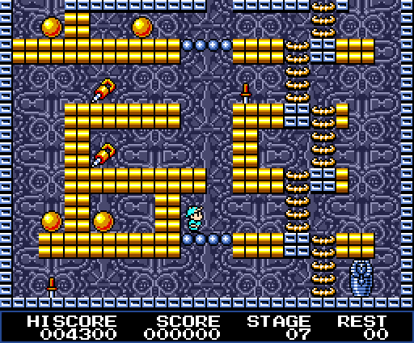
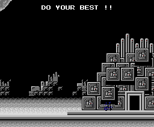
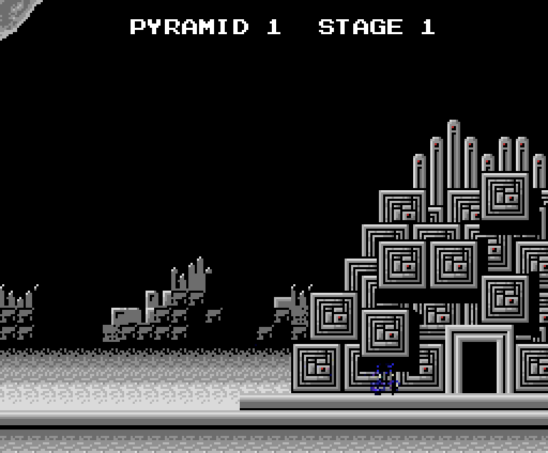
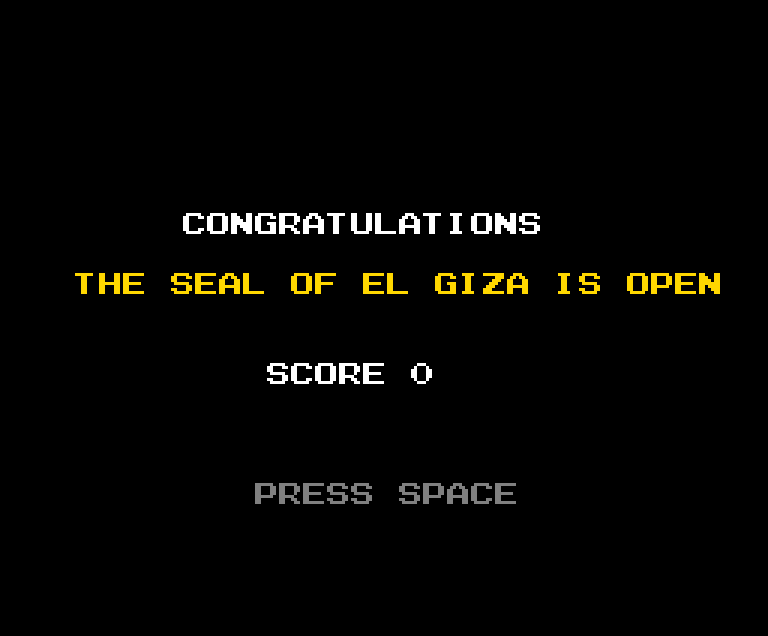
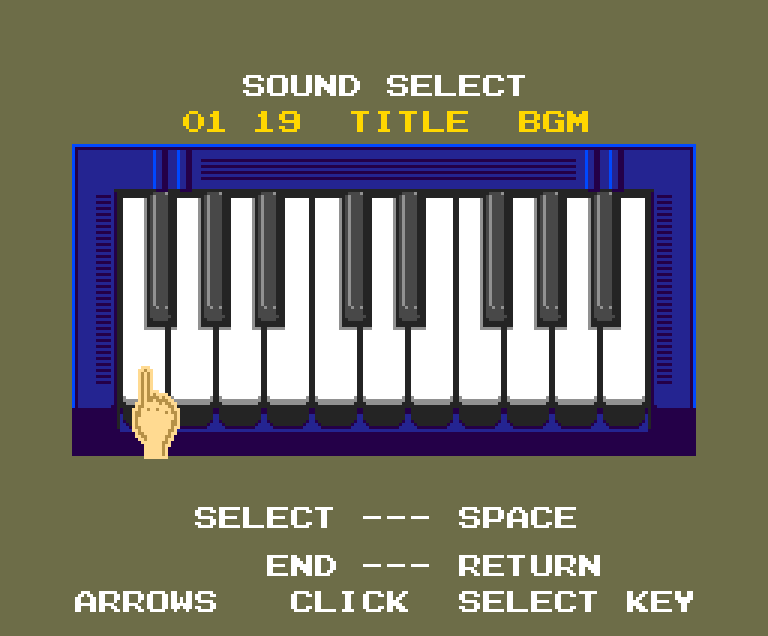

# Gameplay reference

> **Extraction status (2026-11-24):** Current extraction/storage and fidelity evidence are maintained in [EXTRACTION_HANDOFF.md](../EXTRACTION_HANDOFF.md) and [GRAPHICS_EXTRACTION_AUDIT.md](../GRAPHICS_EXTRACTION_AUDIT.md). Historical emulator experiments and port behavior notes below are not claims of complete current cartridge extraction.

Every mechanic of the port, with the ROM address it comes from and an animated capture made with the
in-game capture tooling (see [README.md](README.md#how-to-read-the-captures)).

All timings below are in **logic ticks**. One tick = one call of the original game loop ≈ **1/30 s**
(the VBL handler is locked by `E206`, so about half of the 60 Hz frames are skipped). A ROM counter
that is decremented once per call therefore counts **ticks**, not video frames.

---

## The Vick

| Action | Rule | Source |
| :--- | :--- | :--- |
| Walk | 2 px/tick, 3-point wall probe at `y`, `y+6`, `y+12` | `9F9A` / `9910 probe_step` |
| Jump | initial velocity `E292`, gravity per tick, 3-point landing probe | `A190` / `A1C1` |
| Climb | 1 px/tick up (probe at `y+0x0A`) and down (feet at `y+0x10`); snapping on the column | `A5A2` / `A591` |
| Fall | 4 px/tick straight down; lands on any non-empty cell under the feet | `A2F0` |
| Start falling | pose 7 for 7 ticks, landing sound `0x38`, fall whistle `0x3C` cut by the landing | `9FD4` / `A000` |
| Death | spins 5× (poses 0..3, 3 ticks each), lies down for `0x28` ticks, then the life is lost | `A31C hurt_tick` |
| Hit | same machine with shorter timings (D=5/E=4/C=0 vs D=0x0A/E=6/C=4) | `A31C` |

> **Knife throw** — the windup is 8 ticks (`E286 = 8`, one `DEC` per call); the pose changes at
> `E286 == 4` and the tool leaves at 0 (`A384 vic_throw` → `A38F throw_done`). The knife then flies
> at **4 px/tick** (`A826 tool_step_x`) while the spin animation advances every 2 calls
> (`A87F knife_anim`, `E203 & 1`).

---

## Digging

| Tool | Item id | Effect | Sound |
| :--- | :--- | :--- | :--- |
| Shovel | 3 | digs the cell below and ahead | `0x15` |
| Pickaxe | 4 | digs straight down | `0x17` |
| Hammer | 5 | breaks one column of wall ahead | `0x18` |
| Drill | 6 | drills down through several cells | `0x16` |

The dig state lasts `0x20` ticks (`A0E9`); the tool turns into the crumble animation
(`AA66..AC58`) and the floor becomes air. The sound repeats every 4 ticks.

---

## Items and soul stones

* Walking over an item picks it up (id `0x19` sound). Only one item is held at a time.
* **Soul stones** (`E700` table, 16 per stage) are worth **500** points each (`9A04`, BCD `0x500`).
* When the last stone of the stage is taken, the exit door unlocks: sound `0x0B`, and the **studs**
  on the door disappear one per stone.
* Standing on the open door starts the stage-clear sequence (below).

> **Stage clear** (`E257` script, `71E6`): the door opens **30 ticks per frame** (3 frames = 90
> ticks), the Vick enters the door in 128 ticks (8 interleaved poses, rising 2 px every 16 ticks),
> the curtain closes in 12 bands of 4 ticks (48), then the end screen: **180 ticks** of text, the
> password, and a wait for a key. The whole sequence is 266 ticks ≈ 8.9 s — verified against the
> longplay (door closed at 128.0 s, "NICE! LET'S GO NEXT STAGE" at 134.0 s = 6 s for the 180-tick
> text).

---

## Weapons

| Weapon | Behaviour |
| :--- | :--- |
| Knife | flies 4 px/tick until it hits a wall/enemy; then aligns to the cell, spins for `0x18` ticks, falls and becomes an item again |
| Boomerang | 10-step speed profile (`boom_dx` / `boom_dt`), turns around at step 5 and comes back; caught by the Vick within `0x0D` px |

* Max 6 tools in flight at once (`use_throw`, `0xE2A9`).
* A tool that leaves the room **continues in the neighbour** (`A826 step_wrap` + `room_link`,
  `IX+3` = its screen; `AA17 tool_wrap_y` for the fall). It only collides, hits, sounds and renders
  in the room the Vick is in.
* The knife only plays its landing sound (`0x36`) if it lands in the Vick's room.
* Hitting an enemy locks the tool (`A787 tool_lock`), which then spins and falls.

---

## Enemies

| Enemy | E500 type | Notes |
| :--- | :--- | :--- |
| Mummy (Slouman) | 1 | walks at 1.5 px/tick, climbs ladders, follows the player, can cross rooms (`B00F`/`B0A6`) |
| Gold mummy (Flouman) | 2 | faster, digs through walls |
| Pyoncy | 3 | hops, spins, climbs ladders; spawns from a cloud |
| Rock Roll | 4 | embedded in a ceiling/wall, drops when the player passes under, rolls and bounces, then becomes a pushable block |

> Stage 3 room 2 shows both: the **Pyoncy** at (160,104) and the **Rock Roll** at (160,16). Both are
> E600 *actors* (types 2 and 3) that the ROM spawns through `spawn_pyoncy` (`B274`) and
> `spawn_rockroll` (`B67E`) — they are not just map walls.

---

## Mechanisms (E600 actors)

The `E600` table holds 16 records of 16 bytes. Type byte and byte 8 (height) drive everything:

| Type | What it is | Behaviour | Source |
| :--- | :--- | :--- | :--- |
| 1 | **Rotating door** | 2 cells wide × `byte8` tall. The Vick pushes it from the correct side while holding the direction; the phase (`IX+5`, 0..3) advances every 10 ticks, the bar rotates, and the Vick creeps 2 px/tick through it. Each phase step plays `0x21`. | `0xBABF..0xBB42`, `vic_pull_l/r` `A350`/`A36C` |
| 2 | **Pyoncy** | spawned as an enemy (see above); the ROM also stamps its cell as wall while it is idle | `0xB274` |
| 3 | **Rock Roll** | spawned as an enemy; never stamped as wall (`63B7` returns early) | `0xB67E` |
| 4 | **Trap** | a 4-cell-wide **floor bar**. Standing on it arms it; when the Vick leaves it **while standing**, a counter goes 1, and on the **second** time it fires: sound `0x27`, the 4 cells are cleared and the floor collapses under anyone on it. | `0xBD21 tick_trap`, `0xBD7A trap_punch`, `0xBD65 trap_erase` |
| 5 | **Pushable stone** | a 2×2 block; walking into it pushes it when the way is clear. Its 2×2 wall follows it (`B9A2`). | `0x93F3 tick_stone` |

> The rotating door in stage 2 at (160,72) is stored with phase **3** (already rotated), so it is
> pushed from the **right** (hold left). The one at (80,104) starts at phase 0 and is pushed from the
> left. Both are wall cells in the map (`63DA..6438`) and the player passes only **by pushing**.

> The trap in stage 7 room 2 at (112,144) is the 4-tile bridge over the gap. After the Vick steps off
> it for the second time the bar disappears and the gap is real.

---

## Opening cutscene

Before the first stage, the original plays a short **cutscene in front of the pyramid**: the Vick
walks in from the left, climbs and drops over the pyramid base, reaches the door (screen X = 216),
then fades to black; the valley map follows with the **"DO YOUR BEST !!"** message. The port runs it
when a game starts from the menu (`GoToIntro`), then loads stage 1:

Everything in it was **measured in openMSX** (`tools/kv2-extract/work/gen/intro_*.tcl`: SAT + palette
dumps at 30 Hz), because the previous screen came from the longplay video and had the Vick *baked*
into the bitmap (so he could never move) and the wrong palette (the video's brown sky instead of the
VDP's black):

| What | Measured |
| :--- | :--- |
| Background | `pyramid.bin` (VRAM dump + VDP palette, `art/intro_build.py`) — no Vick in it |
| Walk | `X = 1 + tick`, `Y = 168 → 142 → 160` over the pyramid base, **1 px per tick** (30 px/s) |
| Poses | the game's own walk cycle (`vick_s0_03/04/05/04`), 8 ticks each |
| Door | at `X = 216` the ROM switches to the door pose set (`vick_d_*`) |
| Fade | palette 13/14 ramp to black (≈2.5 s) |
| Message | `intro_msg.bin` — the map screen with `DO YOUR BEST !!` already stamped by the ROM |

> Any key/click skips the walk to the message, and again to the stage. The hallway walk
> (`strm_hallway` 0x5A5C) and the three pictures (`wpic0..2`) of the full ceremony still need the
> bank `EF` art extraction.

---

## The world map (between pyramids)

Finishing the 10th stage of a pyramid sends the game to **`mode_world`** (`0x4B4C` → `world_tick`
`0x6F5D`), not straight to the next stage. Its `world_script` (`0x6F63`) is an 11-step ceremony in
`E257`:

| Step | Routine | What it does |
| :--- | :--- | :--- |
| 1 | `world_scr` `0x6F84` | builds the map screen (palette, tiles, the Vick position), starts the **world-map BGM** (`sfx_0d`, id `0x0D`) and waits `0x3C` ticks |
| 2 | `world_hold` | hold |
| 3 | `world_tour` | the Vick walks the map path (8-tick steps) |
| 4..6 | `world_pic0/1/2` | the three pyramid pictures |
| 7 | `world_out` | the map shrinks |
| 8..10 | `world_count`, `world_sat`, `world_in` | counters and the Vick re-entering |
| 11 | `world_exit` | back to the stage |

The port shows the map screen (the native cartridge screen and the world-map music) for the ceremony
and then starts the next pyramid:

> The step-by-step walk and the `wpic0..2` pictures are **not** reproduced yet — their art lives in
> bank `0xEF`/the `wmap` tile set and still has to be extracted (see the roadmap in
> [ROM_ENGINEERING.md](ROM_ENGINEERING.md#open-findings-and-deviations)).

---

## Ending and the final menu

After stage 60 the ROM switches to **`mode_end`** (`0x4B6E`): substate 1 is a delay, substate 2 runs
`end_menu` (bank `0x0C`) — the menu with the **sound select** and the puzzle — and substate 3+ draws
the ending text (`end_text`, streams at `0x9D37 + 2*(EF10-1)` in bank `EF`); `mode_endtxt`
(`0x4BAF`) scrolls it and returns to the title.

The port shows the ending card with the extracted **`ending`** theme and the final score, and then
opens the final menu — currently the [sound test](#sound-test-the-snd_sel-of-the-ending-menu):

> The puzzle and the exact ending texts still depend on locating the bank `0x0C` module and the
> `0x9D37` text table (see [ROM_ENGINEERING.md](ROM_ENGINEERING.md#open-findings-and-deviations)).

---

## Sound test (the `snd_sel` of the ending menu)

The sound select is the **real screen of the ROM**, not a reproduction: the ending menu (bank `12`
— `0x0C` in the mapper, file offset `0x18000`; `end_menu` at `0xB534` → branch `0xB917`) draws a
**piano keyboard** with the hand cursor moving over **19 keys**. The art was captured by dumping the
VDP in openMSX with the screen forced (`mode_end`, `EF10 = 1`) — no video involved:

* The background is `sound_select.bin` and the hand is a separate sprite (`sound_select_cursor.bin`);
  both live in `Content/Rom/Art/Screens/` as native MSX2 Screen 5 data, assembled at runtime by
  `ScreenAssembler` + `ScreenBuilder` (no PNG).
* The 19 key positions come straight from the ROM's table `0xB9FA`
  (`2C 33 3C 45 4C 55 5C 6C 73 7C 85 8C 9C A3 AC B5 BC C5 CC`) — the irregular spacing is the black
  keys.
* Cursor moves with the ROM's cursor sound (`0x42CB`); Space plays the key; Esc/Return/End leaves.
* The exact id order of the 19 keys is still in the module's note table; the port maps the keys to
  the extracted music and the best-known effects, and — like the original — shows no names.
* Reachable with `KINGSVALLEY_START_SCENE=soundtest`; the ending links to it.

---

## Score, extra lives and the HUD

* Enemy hit: 100 (`9B76`); soul stone: 500 (`9A04`).
* Score is a 3-byte BCD (`E226..E228`). Every 30 000 points the ROM grants a life: threshold `E245`
  starts at 3 (30 000) and grows by 3 (60 000, 90 000 …). The port raises the `REST` counter and plays
  sound `0x2A`. There is **no visual card** in the original either.
* The HUD shows `HI SCORE`, `SCORE`, `STAGE` and `REST`, drawn by Gum with the game font.

---

## Secret entrances (analysis — not ported, because they are dead in the official stages)

The `E7C0` table holds 16 secrets per stage (4 bytes: room, Y, X, flags); 112 exist across the 60
stages (extracted from the RAM dumps, e.g. stage 9 has one at room 1, `Y=120`, `X=160`). The ROM's
rule (`0xBE15 secret_hit` → `0xBE2D secret_reveal`) is:

* The secret box is `height = (flags & 0x1F) * 8 + 0x18` px tall, `0x10` px wide, anchored at
  `(X, Y - 0x14)`.
* While the Vick is **climbing** inside the box, bit 5 of the flags is armed (`0xBE6C`).
* When he is inside the box with the *air/land strobe* (`E2A7`, set by landing) the strobe and the
  armed bit are consumed. If `(flags & 0xC0) >> 6 == 1` the ROM "punches" the wall (a 2×1 wall at the
  secret's row, then 2×1 of air below, sound `0x40`) and removes the record.
* **But** the ROM loader (`0x44AC secret_store`) always writes `flags = (record & 0x1F) | 0x80` —
  confirmed at `0x44B4` (`F6 80` = `or 0x80`) in the ROM image — and every official record reads back
  `0x80`, `0x86`, `0x8E`… i.e. the punch branch (`== 1`) can never be taken. In the 60 campaign
  stages the secrets are therefore **inert**: they consume the arm/strobe and do nothing else.

Because the feature has no reachable effect in the campaign and the `E7C0` table is not part of the
extracted level JSON, the port does **not** implement it — inventing an effect would be less faithful
than leaving it out. Should a future editor record carry `0x40` in the top two bits, the punch branch
would have to be ported together with the `E7C0` extraction.

---

## Palette animation and audio

* The pyramid palette animates colour 6 (black → red → white) every 4 ticks with an extra step in
  pyramid 4 (`5C14`, table `0xBD52`), driven by `PaletteAnimator` from `animations.json`.
* SFX are extracted per numeric driver ID into the flavor-specific `Audio/audio.msxaudio` package as chip-register events. The PSG has **one channel per
  effect**, so re-playing the same id **restarts** it instead of stacking (the port configures one
  voice per sound) and the landing sound cuts the fall whistle.
