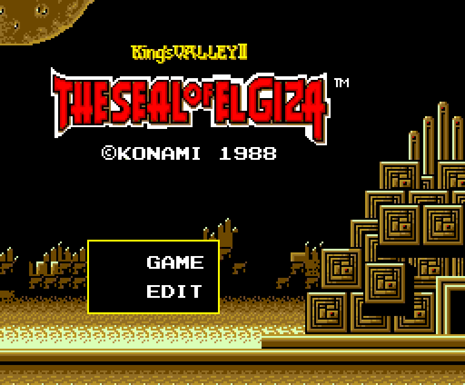
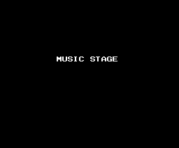
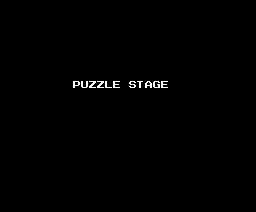
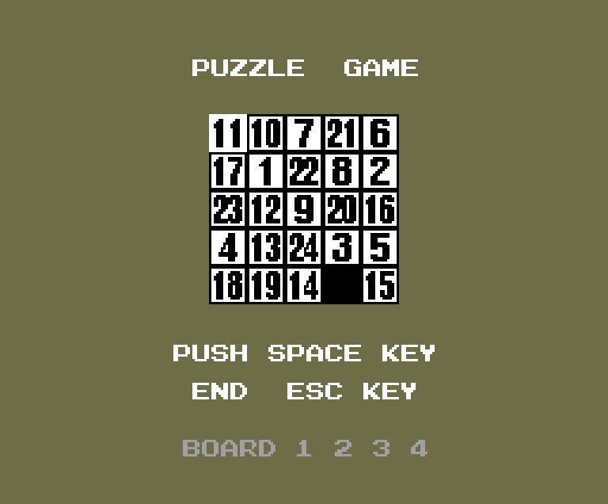
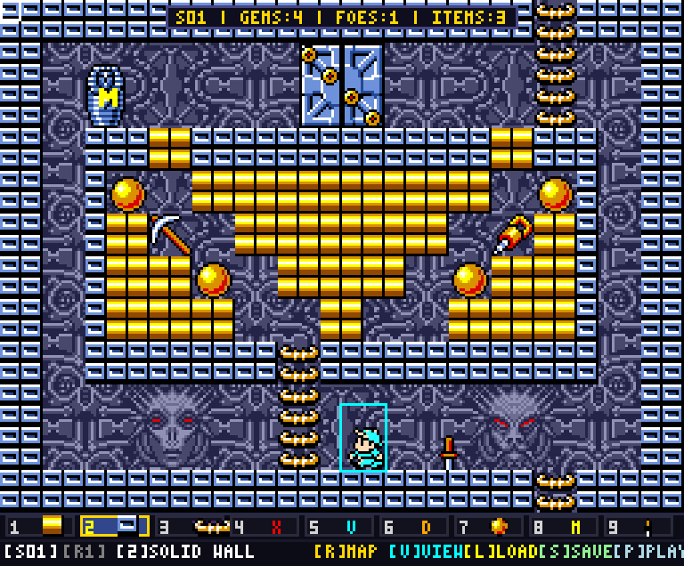
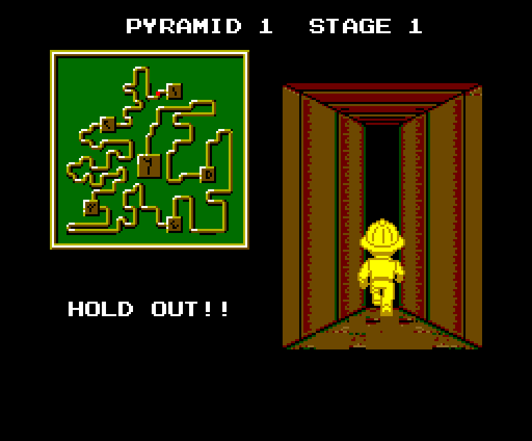

# King's Valley II — MonoGame port (English documentation)

A faithful re-implementation of **King's Valley II: The Seal of El Giza** (Konami, 1988) for the
**MSX2**, written in C# with **MonoGame + Nez + Gum**.

The game logic is ported *rule by rule* from the original ROM: every constant, timer, probe and
animation frame below was read from the disassembly or measured in openMSX (C-BIOS, MSX2, SCC).
Nothing is estimated unless it says so.

<p align="center">
  
  <br><em>The boot: the Konami logo is revealed line by line, exactly as the ROM's <code>wmap_slide</code> does (48 lines, one every 2 video frames), then the screen cuts to the Japanese title.</em>
</p>

---

## Table of contents

| Document | What is inside |
| :--- | :--- |
| [GAMEPLAY.md](GAMEPLAY.md) | Every mechanic, enemy, item and mechanism with animated captures |
| [ROM_ENGINEERING.md](ROM_ENGINEERING.md) | How the port was reverse-engineered: the clock, the RAM tables, the extracted data, the open findings |
| [ARCHITECTURE.md](ARCHITECTURE.md) | The C# layout (Core / Engine), scene flow, Gum UI, asset pipeline, tests and diagnostics |
| [media/](media) | Every GIF/screenshot used here, plus the raw frame dumps |
| [tools/docs/capture.ps1](../../tools/docs/capture.ps1) | Reproduces all the captures (scripted input + frame dump + GIF) |

---

## Quick start

```bash
dotnet build KingsValley.slnx
dotnet run --project src/KingsValley.Desktop
dotnet test
```

The game needs the data extracted from **your own ROM** (`tools/kv2-extract`, see
[ROM_ENGINEERING.md](ROM_ENGINEERING.md#the-extraction-toolchain)). Without it the game still boots
but there are no stages, art or audio.

### Controls

| Action | Keyboard | Gamepad |
| :--- | :--- | :--- |
| Walk / climb | Arrows or WASD | D-pad / left stick |
| Use / throw / jump | **Space** or **Z** | A |
| Pause | **F1** or **P** | Start |
| Leave the level (scene) | **Esc** | Back |
| Menus: confirm / back | Space/Enter / Esc | A / B |
| Mouse and virtual cursor | both work (the Gum UI uses a custom cursor) | — |

---

## Feature status

Everything below is implemented and covered by the automated tests; the ones marked *(deviation)*
are documented in [ROM_ENGINEERING.md](ROM_ENGINEERING.md#open-findings-and-deviations).

| Area | Status |
| :--- | :--- |
| 60 stages, 8×8 room grid, room wrapping | ✅ loaded from the ROM data |
| Walk / jump / climb / fall | ✅ measured physics (2 px/tick walk, 4 px/tick fall) |
| Digging: shovel, pickaxe, hammer, drill | ✅ with the ROM's crumble animation |
| Items and soul stones, exit door + studs | ✅ |
| Weapons: knife and boomerang | ✅ per-tick steps, room wrapping, catch, spin sounds |
| Enemies: mummy, gold mummy, Pyoncy, Rock Roll | ✅ ported AI (one 1:1 tick trace, 0 different frames) |
| Mechanisms: swivel door (type 1), one-way revolving door (type 2), pushable stone (type 4), trap (type 5) | ✅ E600 types 1, 2, 4, 5 with authentic 4-phase 360° rotation and mural restoration |
| SaveState & LoadState | ✅ 3 instant slots in the ESC menu with real-time PNG thumbnail capture and atomic JSON |
| MSX1 & MSX2 Dual Engine | ✅ Real-time toggle (F11/ESC), TMS9918A SCREEN 2 (1:1 square pixels, 10px letterbox) and MSX2 SCREEN 5 |
| Mural & Palette Animations | ✅ MSX2 color-6 palette cycling + MSX1 byte-by-byte mural blinking eyes VDP animation |
| Stage clear: door, entering, curtain, text, password | ✅ |
| Extra life at 30 000 / 60 000 / 90 000 | ✅ with sound `0x2A` and the REST counter |
| **Game over + continue** (`mode_over`) | ✅ the ROM's blank screen and `game  over` / `f5  continue` texts; the continue is the **`TRYAGAIN` password cheat** (stage 1, REST 1, score 0) and the window is 120 ticks, exactly as the ROM |
| Splash: logo reveal → Japanese title | ✅ straight from the ROM's boot code |
| **World map between pyramids** (`mode_world`) | ✅ map screen + music + the **Vick tour** (`0xBA57`, 8 ticks/step); only the `wpic0..2` world-complete stamps are pending (see [ROM_ENGINEERING.md](ROM_ENGINEERING.md#11-the-world-map-ceremony-world_script-0x6f63)) |
| Cutscenes (intro/`kind_play`, hallway, pictures) | 🟡 the opening cutscene is in (Vick walks to the pyramid and fades, measured in openMSX); the hallway/pictures wait on the bank `EF` art |
| Ending (`mode_end`/`mode_endtxt`) + the `end_menu` (**sound test**, puzzle) | ✅ ending card + music + flow; the `end_text` card (`MUSIC STAGE` / `PUZZLE STAGE`, table `0x9D37`), the **real sound test** (19 keys/ids from `0xB98A`) and the **real 5×5 puzzle** (`0xB6B0`, one of four scrambled boards, `+3 REST` on a win) are in; the page follows `EF10` (`0xB548`), so **stage 60 opens the puzzle** |
| Stage editor | ✅ the 32×24 room paints, saves (validated by the game's loader) and **play-tests in the real game**; the ROM's 11-item legend with sub-types (enemy/trap/tool) and the room map are in |
| HUD, palette animation, music and SFX | ✅ |
| Secret walls (jump-reveal) | ⚠️ dead feature in the official stages — analysis in [ROM_ENGINEERING.md](ROM_ENGINEERING.md#secret-entrances-are-dead-in-the-official-stages) |
| `EF10` pyramid FX, trap punch VFX | ❌ not ported (visual-only modules, see the findings) |

<p align="center">
  
  <br><em>The Japanese title screen (<code>title_jp</code>, 0x5F8D) that the boot builds after the logo.</em>
</p>

<p align="center">
  
  
  <br><em>The <code>end_text</code> card, printed from the ROM's own streams: <code>EF10=1</code> →
  <b>MUSIC STAGE</b> at (80,80) and <code>EF10=2</code> → <b>PUZZLE STAGE</b> at (72,80), after the
  120-tick blank screen.</em>
</p>

<p align="center">
  
  <br><em>The <code>PUZZLE GAME</code> of the final menu (bank <code>0x0C</code>, <code>0xB6B0</code>):
  a real 5×5 sliding board built from art captured out of the ROM's VDP dump.</em>
</p>

<p align="center">
  
  <br><em>The stage editor port (<code>KINGSVALLEY_START_SCENE=editor</code>): the stage-1 room with the
  ROM's four terrain kinds, the paint cursor and the save that re-parses the file through the game's own
  loader.</em>
</p>

<p align="center">
  
  <br><em>The world-map interlude with the <b>Vick tour</b> of the ROM: position from <code>world_xy</code>
  (0x71CA), path from <code>0xBA57</code>, one step every 8 ticks — the coordinates go straight to the
  SAT (<code>tour_vic</code> 0xBDDA), so they are screen pixels.</em>
</p>

---

## How to read the captures

Every GIF in these docs was produced by the game itself:

1. `KINGSVALLEY_CAPTURE_DIR` + `_FROM`/`_TO` makes the game dump `frame_NNNN.png` from the final back
   buffer (scene + Gum UI) and quit at the end of the window.
2. `KINGSVALLEY_INPUT=<file>` replaces the keyboard with a tick-by-tick script, so the demo is
   deterministic (the format is documented in the file header).
3. `KINGSVALLEY_PLAYER=room,x,y` places the Vick next to the feature being recorded.
4. `tools/docs/make_gif.py` turns the frames into a GIF at the game's real cadence
   (60 fps capture, one logic tick every 2 frames).

```bash
# reproduces every capture into docs/en/media/
powershell -File tools/docs/capture.ps1
# or a single one:
powershell -File tools/docs/capture.ps1 -Only trap
```

---

## Runtime Screen and Background Assembly (Zero Static PNG Backgrounds)

No static PNG image files are used for any background or screen in King's Valley 2:
- **Gameplay Stages**: Assembled at runtime by `RoomAssembler` and `RoomBackgroundBuilder` from raw 4bpp tile blocks (`blocks_p*.bin`), mural tables (`murals.json`), decorations (`decorations.json`), and palette tables (`palettes.json`) with the animated color 6 cycling routine.
- **Screens & Backgrounds** (World Map, Title, Start Select, Pyramid intro, Konami logo, Sound Select, Puzzle): Stored in native MSX2 Screen 5 binary format (`.bin` in `Content/Rom/Art/Screens/`), containing the 32-byte VDP color palette (`(R<<4)|B, G`), dimensions, and 4bpp nibble-packed pixels. The pure C# `ScreenAssembler` decodes them and `ScreenBuilder` constructs the MonoGame `Texture2D` in runtime via `SetData<Color>()`.

---

## Legal

The game, its art, music and the ROM data derived from it belong to **Konami**. This repository ships
**no** ROM-derived content: the game extracts everything at runtime from a cartridge dump supplied by
the user. See [ROM_EXTRACTION.md](../ROM_EXTRACTION.md) for the extraction rules and
[EXTRACTION_HANDOFF.md](../EXTRACTION_HANDOFF.md) for the current engineering checkpoint.

The `docs/en` tree is the illustrated reference; `docs/*.md` keeps the engineering notes about the
ROM port. Both are written in English.
